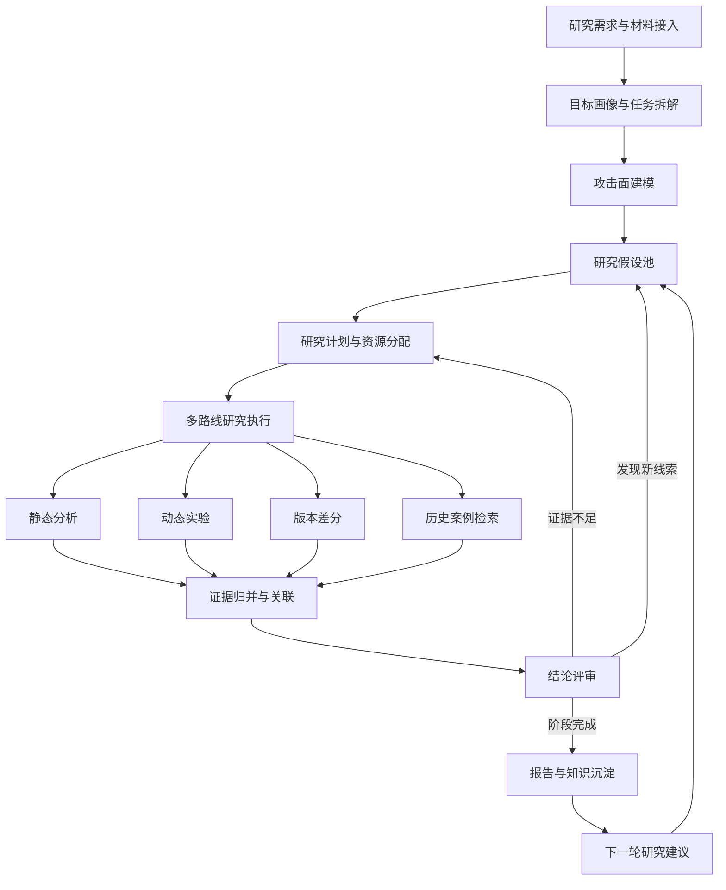

# ssj 项目背景与研究工作流设计

日期：2026 年 11 月 12 日。状态：讨论稿，等待项目负责人进一步调整。

本阶段优先建设适合演示和汇报的安全研究工作流，重点展示任务拆解、多路线编排、证据关联、评审迭代与知识沉淀。真实漏洞发现和实际研究产出不作为当前验收条件；演示可以使用预设场景和模拟结果，并标明模拟执行。本文记录背景与拟议方案，暂不启动代码修改。

流程进一步采用人类专家主导的多 Agent 协作：AI 整理可追溯事实、提出待验证问题并执行实验；人类专家判断研究价值、方向与最终结论。角色职责、评审退回和专家知识库详见 [多 Agent 协作与专家参与设计](multi-agent-workflow.md)。下文为整体流程，具体决策权限以该设计为准。

## 研究者背景

项目负责人是大厂安全研究员，主要从事移动端安全、逆向与二进制研究，已有 Apple TCC、App Sandbox 和系统服务权限边界方面的研究积累。年底绩效汇报是当前的重要使用场景，需要有足够内容说明工作思路、系统设计和技术过程。

本项目的近期关注点已明确为 workflow 的丰富程度、演示效果和可讲述的系统设计。此前围绕新增漏洞、真实实验效果和工具实际采用提出的目标，不作为这一阶段的默认要求。

## 相关平台与工具背景

以下关系来自项目负责人提供的历史讨论材料，作为本项目的设计背景。

| 系统或工具 | 背景职责 | 对本项目的参考价值 |
| --- | --- | --- |
| ATuin 组件体系 | 样本收集、静态分析、设备管理、动态采集、任务编排和结果展示，覆盖多个移动平台 | 参考工具与设备如何组成完整分析流程 |
| 新版 ATuin 安全研究工作台 | 研究会话、项目协作、目标与组件管理、漏洞报告、知识管理和用量统计 | 参考研究任务如何组织、展示和沉淀 |
| Dagger | Rust 静态安全与隐私分析引擎，涉及调用关系、数据流和声明式规则；历史材料记录了 `audit <样本路径>` 接入形式 | 作为静态分析节点的候选工具 |
| 当前 ssj 仓库 | 本地研究工作台，包含任务队列、文件索引、规则分析、模型审查和 Codex 实验适配 | 作为后续演示工作流的实现基础 |

历史调查未完全确认新版 ATuin 页面与源码仓库的对应关系。这里的流程参考不意味着 ssj 已接入 ATuin 的设备、任务或知识服务。

## 当前项目目标

1. 形成层次丰富且依赖关系清楚的研究流程，能够展开说明每个阶段的职责、输入、输出和决策。
2. 展示多条研究路线如何分工、并行、汇合，以及如何根据中间结果调整计划。
3. 让任务状态、工具调用、证据关系、评审意见与研究历史成为可见的演示内容。
4. 支持用预设场景和模拟结果走通流程，真实分析器和真实实验可按后续需要逐步接入。
5. 为汇报提供架构图、执行轨迹、阶段产物和完整案例，解释系统的组织方式与扩展方向。

当前不以新增 CVE、真实漏洞数量、分析准确率、生产部署或真实 Dagger 端到端接入作为完成条件。汇报中的能力状态按“已实现、设计中、模拟演示”区分，模拟数据不作为实际研究成果或运行指标。

## 仓库现有能力

现有主流程为：创建任务 → 文件索引与静态规则分析 → 可选模型审查或 Codex 执行 → 保存结果 → 导出报告。

- `app.py`：本地 HTTP API、SQLite 持久化、单工作线程队列、规则匹配和报告导出。
- `codex_runner.py`：复制已索引目标，校验哈希，调用 Codex 编写和执行实验，收集事件、产物和结构化结论。
- `research_tools.py`：封装本机二进制工具与 Dagger 命令适配。
- `static/`：任务创建、状态轮询、证据与实验产物展示。

现有队列使用单工作线程，尚未实现下文的任务 DAG、多路线并行和自动评审迭代。Dagger 有适配入口，仓库文档记录的端到端验收仍未完成。已有架构说明见 [架构与接口](architecture.md)。

## 拟议研究工作流

| 阶段 | 输入 | 核心处理 | 可展示产物 |
| --- | --- | --- | --- |
| 需求与材料接入 | 研究问题、源码、二进制、历史材料 | 整理目标、范围和预算 | 研究任务卡、材料清单 |
| 目标画像与任务拆解 | 目标材料和研究要求 | 整理平台、组件、依赖、入口与已有记录，拆出子问题 | 目标档案、组件关系图、子任务清单 |
| 攻击面建模 | 目标画像 | 关联外部入口、敏感操作、权限和信任边界 | 攻击面地图、入口列表 |
| 假设生成与排序 | 攻击面和历史材料 | Agent 提出可证伪假设并列出证据、条件和成本估计，专家决定研究优先级 | 假设池、专家决策记录 |
| 研究计划与资源分配 | 已排序假设 | 拆解步骤，选择工具，设置依赖、并发和预算 | 任务 DAG、节点配置、研究计划 |
| 多路线执行 | 研究计划 | 组织静态分析、动态实验、版本差分和案例检索 | 执行轨迹、工具记录、阶段进度 |
| 证据融合 | 各路线的输出 | 将代码位置、调用链和实验日志关联到假设，标记冲突与缺口 | 证据关系图、覆盖矩阵 |
| 结论评审 | 假设和关联证据 | 评审 Agent 检查证据与实验完整性，专家决定研究价值、路线取舍和阶段结论 | 证据缺口、专家意见、后续任务 |
| 报告与知识沉淀 | 阶段结论和执行记录 | 汇总报告、负结果、实验模板和后续问题 | 阶段报告、知识条目、研究时间线 |

各研究路线内部可以使用有向无环图表达任务依赖；跨轮反馈通过新建一轮计划表达。这样既能展示单轮执行顺序，也能保留多轮研究历史。

## 三个反馈循环

### 假设循环

执行节点发现新入口或新关联时，生成候选假设并加入假设池。Agent 去重并列出验证条件与成本估计，专家决定优先级及是否进入本轮预算。演示重点是展示研究计划如何随线索变化。

### 验证循环

评审节点发现证据不足、结果冲突或实验条件不完整时，生成补充任务，并关联原假设与缺失证据。补充任务完成后再次评审，保留每轮意见和结论变化。

### 知识循环

阶段结束后，将目标画像、研究结论、负结果和实验模板整理成知识条目。后续任务可以检索这些记录，并把引用关系显示在计划和报告中。

## 贯穿流程的控制能力

以下控制能力作为后续讨论的候选范围：

- 人工介入：修改研究问题、调整假设优先级、补充材料、选择后续路线。
- 暂停与恢复：保存当前阶段和节点状态，恢复后继续处理剩余任务。
- 失败与重试：展示失败原因、重试记录，以及替代工具或跳过节点的选择。
- 预算调整：设置研究时间、并发方法数和调用预算，并展示对计划的影响。
- 依赖与汇合：说明节点何时可以执行、哪些结果尚未返回、哪些分支影响评审。
- 历史回放：按轮次查看计划、工具事件、证据变化与评审结论。

演示时，每个节点宜具备输入、输出、状态、关联假设和执行记录。模拟节点使用预设数据推动状态变化，并显示执行来源。

## 演示案例组织方式

可选取一个虚构的系统服务权限边界场景，贯穿完整演示：提交研究目标 → 生成组件与入口图 → 建立三个候选假设 → 分派静态、实验和历史检索路线 → 汇合证据 → 评审发现一处缺口 → 追加验证节点 → 形成阶段报告和下一轮建议。

这个案例用于展示编排、反馈和产物关联。场景中的目标、证据、结论及耗时均可预设，页面与导出报告应保留演示标识。

## 后续调整方式

本轮仅保存背景、目标与工作流草案，代码保持现状。后续由项目负责人提出具体调整，再确定阶段划分、角色设置、页面呈现、演示场景和实现优先级。

当前优先待讨论的是：哪些阶段需要重点展示、多角色如何分工、哪些反馈循环需要可交互、以及真实工具与模拟节点如何组合。这些尚未确定为开发承诺。
