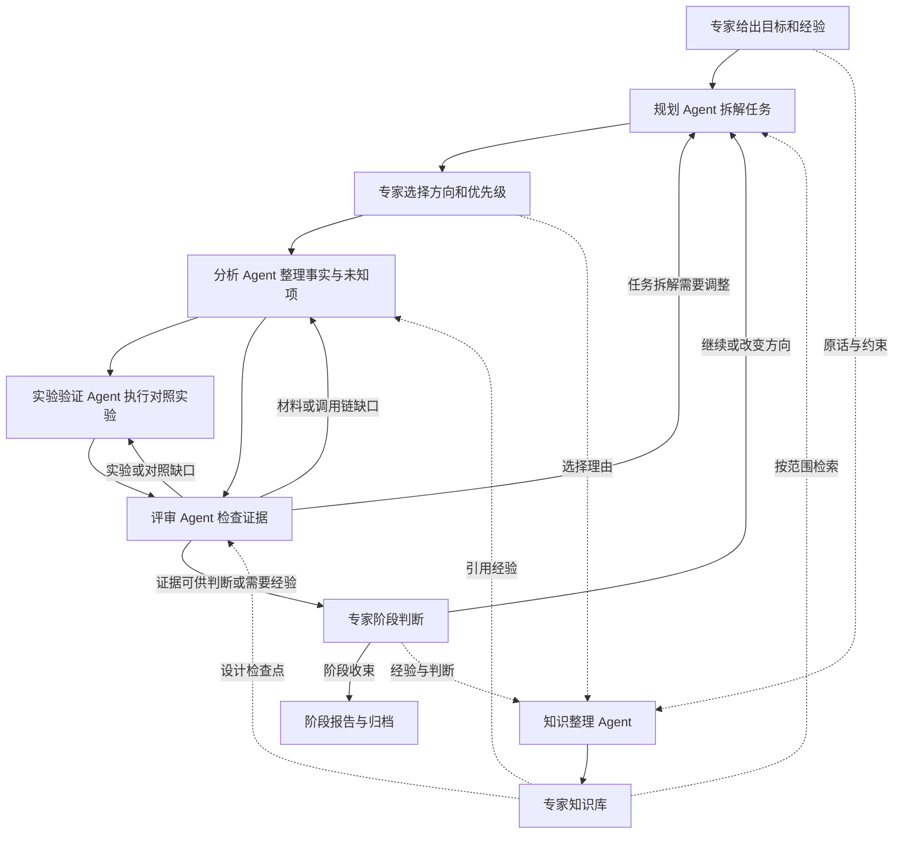

# 多 Agent 协作与专家参与设计

日期：2026 年 11 月 12 日。状态：完整方案讨论稿；首版已实现脚本驱动的角色流转、评审退回、专家插话及知识归档演示，具体范围见 [演示说明](demo-guide.md)。

本设计在 [项目背景与研究工作流](background-and-workflow.md) 上细化角色、流转和人工参与。人类安全专家掌握方向与结论的决策权；Agent 负责整理材料、提出可验证的问题、执行实验和检查证据。专家可以在任何阶段补充经验或改变方向，系统将这些输入转化为任务约束与可追溯知识。

## 事实与判断的表达方式

Agent 的输出按以下类别呈现，避免将推测写成事实：

| 类别 | 表达要求 | 示例 |
| --- | --- | --- |
| 观察事实 | 指向源码位置、工具输出或实验记录，注明版本、身份和环境 | 在构建 A、普通用户 B 下，实验 C 返回拒绝访问，原始日志为 E12 |
| 待验证假设 | 明确前提、未知项和证伪方式 | 尚未确认重启后授权是否失效，可通过重启前后对照验证 |
| AI 推断或建议 | 与观察分开，列出依据和缺口，作为专家的参考 | 根据已读取的两处调用，建议补查代理路径；运行时是否可达仍未知 |
| 专家判断 | 保留原话、作者、时间和适用范围 | 专家认为当前路径研究优先级低，要求转向代理后的身份绑定 |

“未观察到”只描述已执行范围；实验正常退出不等于假设得到证明。复杂代码分析涉及解释，AI 无法保证完全没有推断，因此必须显式区分观察与推断。研究价值、漏洞定性、影响程度和方向取舍由专家决定。

## 角色分工

| 角色 | 负责什么 | 必须交付什么 | 决策边界 |
| --- | --- | --- | --- |
| 人类安全专家 | 给出研究目标、背景经验和限制，选择方向，纠正假设，形成最终判断 | 自然语言指令、优先级调整、阶段判断；无需填完整表单 | 可随时改变研究方向，决定是否继续及如何表述结论 |
| 规划 Agent | 将专家目标拆成问题、依赖和任务；检索适用知识；根据评审缺口重排计划 | 本轮计划、任务依赖、完成条件、预算估计、引用的专家约束 | 在已选方向和预算内安排执行；方向变化和新增预算交专家决定 |
| 分析 Agent | 阅读源码或二进制分析结果，梳理入口、调用、数据流和版本差异 | 带来源的事实、未知项、可证伪假设、交给实验的前置条件 | 可以建议验证路径，不自行认定漏洞、研究价值或最终优先级 |
| 实验验证 Agent | 根据问题设计并执行对照与边界实验，记录环境和复现条件 | 实验方案、代码、命令、原始输出、预期与实际结果对照 | 描述具体条件下的结果；缺少权限或环境时报告阻塞，失败不得伪装成反证 |
| 评审 Agent | 独立检查引用、实验条件、对照设计、结论范围和证据冲突 | 检查清单、具体缺口、退回对象及补齐标准、提交专家的问题 | 可因证据或方法缺口退回；通过仅表示可供专家判断，不代表确认漏洞 |
| 知识整理 Agent | 整理专家原话与决策，关联适用目标、版本和后续证据 | 候选知识条目、原文链接、版本及冲突记录 | 可以提取和归类，不把专家经验或自身改写自动升级为客观事实 |

任务编排器是确定性的执行组件，维护队列、依赖、状态、预算和消息投递。Agent 提出结构化任务或状态变更请求，由编排器应用规则，避免多个角色同时修改同一任务。

规划、分析、实验和评审使用独立任务上下文，交接通过有版本的产物完成。评审应能读取原始材料和日志，避免只复述上一位 Agent 的总结；角色独立不等于判断必然正确。

## 主流程与退回路径

一个计划可以有多个分析和实验实例并行处理不同假设；有依赖的实验等待对应分析产物。每条路线按自己的完成条件进入评审，允许局部退回，避免整批任务从头重跑。

评审退回必须包含：问题位置、缺失内容、接收角色、补齐标准和所引用的产物版本。例如：“实验只覆盖管理员身份，需增加目标低权限身份的对照，并记录实际身份与返回值。”

建议使用以下评审结果：

- `needs_analysis`：补材料、调用关系或前置条件。
- `needs_experiment`：补实验、对照或可复现记录。
- `needs_replan`：依赖错误或现有任务不能回答研究问题。
- `needs_expert`：证据冲突、适用范围或方向需要专家判断。
- `ready_for_expert`：检查项已满足，事实与未知项可提交专家。

规划与评审在专家预先设定的范围和预算内自动退回，不要求每次重试都由人批准。同一缺口连续两轮无新证据，或达到设定的轮次、时间、调用预算时，整理已有事实交专家决定；轮次阈值为可配置设计值。

## 人工参与位置

| 时机 | 专家看到什么 | 专家需要做什么 | 系统如何响应 |
| --- | --- | --- | --- |
| 研究开始 | 目标、已有材料、关键未知项 | 用自然语言说明想研究什么、已知什么、范围和预算 | 提取约束，生成计划草案 |
| 首轮计划 | 候选路线、已有证据、验证条件与成本估计 | 选择值得投入的路线，或直接指定路径 | 固定本轮方向与优先级，执行细节自动推进 |
| 任意节点 | 当前事实、引用、未回答问题 | 随时纠正、补充经验、排除分支或要求追加实验 | 记录专家指令，更新受影响任务 |
| Agent 遇到阻塞或冲突 | 最小必要背景、冲突证据、一个明确问题及可选操作 | 提供领域知识，或决定如何处理缺失条件 | 只暂停依赖该回答的路线，其他路线继续 |
| 阶段评审 | 已观察事实、实验覆盖、未知项、专家先前判断 | 判断价值、影响、是否成立、继续或结束 | 保存专家结论，生成下一轮计划或报告 |
| 知识整理 | 原话旁的提炼内容及适用范围 | 对重要或有歧义的提炼作批量确认或修正 | 更新知识版本；普通原话归档自动完成 |

专家不必先向 AI 证明经验判断。例如专家说“这条路不用看，重点查代理后的身份”，规划 Agent 立即在当前任务内按此执行，同时将原因记为“专家经验，未提供展开解释”。后续如有相反观察，系统并列呈现并请专家判断，不偷偷丢弃观察或改写专家原话。

专家中途改方向时，编排器保存新的决策版本，暂停或取消受影响任务，保留既有日志。旧版本任务迟到的输出归档为历史结果，不自动覆盖新计划或当前结论。

## 交接产物与研究状态

角色共享的核心对象包括：研究问题、专家决策、计划版本、任务、假设、证据、实验、评审意见和知识条目。任务交接至少携带目标版本、假设编号、输入引用、专家约束、完成条件和预算。

任务状态建议为 `queued → running → completed`，同时支持 `blocked`、`failed`、`cancelled` 和 `superseded`。任务执行成功、评审通过与专家判断分别保存，避免用一个“完成”状态同时表示三种含义。

假设保留“待分析、待实验、待评审、待专家判断、已收束”等研究进度；专家的成立、不成立、条件成立或暂不判断作为独立字段，关联具体条件、证据与原话。

## 专家知识库

知识库同时保存原始发言和提炼条目。原话是可追溯来源，提炼用于检索和复用。

### 整理与复用流程

1. 专家发言自动归档，记录时间、所在任务、引用对象和当时的计划版本。
2. 知识整理 Agent 把发言拆成可独立引用的条目，标记为经验规律、研究方法、目标背景、负结果、方向决策或待验证假设。
3. 保留“可能、只在某版本、我印象中”等限定词。原话不明确的适用范围记为未知，不自行扩大。
4. 明确的任务指令立即用于当前研究。跨任务可复用的提炼先进入候选知识，专家可批量确认、修订或废弃；不逐条打断研究。
5. 规划、分析和评审按平台、版本、组件、身份与研究问题检索知识，并显示原话来源、确认状态和适用范围。
6. 新证据或专家修正与旧条目冲突时建立关联，保留版本链。确认后的新条目可替代旧条目，历史任务仍能还原当时使用的版本。

### 条目字段

| 字段 | 内容 |
| --- | --- |
| 标题与提炼内容 | 简洁表述一条经验、方法或决策 |
| 原始来源 | 专家原话、作者、时间、会话及任务位置 |
| 适用范围 | 平台、系统版本、组件、权限身份、前提；可标记未知 |
| 知识类型 | 经验、方法、背景、负结果、决策或假设 |
| 确认状态 | 候选、专家确认、已替代或废弃 |
| 实验依据 | 尚无实验、存在关联证据或存在冲突证据，与确认状态分开 |
| 关联对象 | 假设、实验、证据、任务及冲突条目 |
| 版本记录 | 每次修订内容、原因和适用变化 |
| 执行来源 | 真实研究或模拟演示；检索时保留此属性 |

“专家确认”表示提炼准确表达了专家意见，不等于已通过实验验证。一次项目中的路线取舍默认是任务决策，只有明确提炼为一般经验后才跨任务复用。模拟演示知识单独标识，默认不进入真实研究的经验检索。

## 专家交互示例

以下为设计示例，并非已有研究结果。

分析 Agent：“当前读取的函数中存在调用者身份检查，位置为 E1；尚未跟踪代理转发后的身份来源。”

专家：“入口这个检查先别纠结，代理之后的身份才是重点。”

规划 Agent：将当前入口复查任务暂停，新建“定位代理后的身份传递”和“设计不同调用者身份的对照实验”，关联专家原话。

实验验证 Agent：记录两个调用身份、同一输入和各自返回结果，不将差异直接写成漏洞结论。

评审 Agent：“两次实验的目标配置不同，现有结果不能隔离调用者身份这一变量。”退回实验角色，要求固定配置后重跑。

专家根据补充结果决定下一步。知识整理 Agent 将原话暂存为“本任务优先研究代理后的身份绑定”，作为任务决策；是否提升为通用检查方法由专家确认。

## 展示与后续实现范围

工作台可以分为研究流程图、角色执行轨迹、事实与未知项、专家决策记录、知识库五个视图。每条专家意见能够跳到受其影响的任务，每条知识能够追溯原话，每次退回能够看到缺口及补齐后的变化。

首版演示已实现确定性节点编排、界面与 SQLite 知识存储。真实模型角色、自动知识提炼、多研究路线并行和完整任务依赖图仍是后续设计范围。
